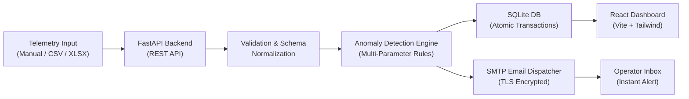

# SentinelFlow: Project Presentation Deck & Oral Defense Script

**Project Title**: SentinelFlow — AI & Rule-Based Anomaly Detection for SCADA Logs in Water Treatment Systems  
**Domain**: Industrial IoT, SCADA Security, Full-Stack Web Architecture, Anomaly Detection  
**Target Audience**: College Engineering Viva Voce Panel, Academic Evaluators, and Technical Reviewers  

---

## Part 1: Slide-by-Slide PPT Presentation Deck

### Slide 1: Title Slide
* **Slide Title**: SentinelFlow: Intelligent SCADA Anomaly Detection & Incident Response System
* **Subtitle**: Automated Telemetry Analysis and Real-Time Operator Alerting for Municipal Water Treatment Infrastructure
* **Student Name & Department**: Computer Science & Design Engineering
* **Institutional Affiliation & Academic Year**: 2026–2027
* **Visual Suggestion**: High-contrast dark industrial theme (`#080e19` background with cyan `#53d6d0` and emerald `#4cdaa2` accents), displaying the SentinelFlow logo and a clean pipeline graphic from Water Treatment Sensors → FastAPI Engine → Real-time React Dashboard.

---

### Slide 2: Problem Statement & Industrial Motivation
* **The SCADA Context**: Supervisory Control and Data Acquisition (SCADA) systems govern critical infrastructure such as water purification, municipal distribution, and sewage filtration.
* **The Vulnerability**:
  1. Traditional water treatment facilities rely on periodic manual inspections or siloed threshold alarms that fail to correlate multi-sensor faults.
  2. A physical fault (e.g., pump bearing wear or pipe blockage) often manifests across *multiple coupled variables* simultaneously (e.g., high vibration + high current + low flow).
  3. Delayed fault detection leads to pipe bursts, contaminated effluent discharge, equipment burnout, and thousands of dollars in downtime.
* **The Solution**: SentinelFlow — an automated, full-stack monitoring and multi-parameter anomaly detection pipeline providing immediate classification (`NORMAL`, `WARNING`, `CRITICAL`), batch log audit, and instantaneous TLS-encrypted email dispatch to safety operators.

---

### Slide 3: Objectives & Key Contributions
* **Primary Objectives**:
  * **Dual Data Ingestion**: Real-time single-reading manual telemetry injection and batch file processing (`.csv` and `.xlsx`).
  * **Deterministic Multi-Parameter Fault Classification**: Analyze 7 core hydraulic and electrical telemetry parameters simultaneously.
  * **3-Tier Severity Grading**: Distinguish between minor operational fluctuations (`WARNING`) and compounding dangerous states (`CRITICAL`).
  * **Operator Incident Response**: Instantaneous automated dispatch of TLS-secured email alerts to field engineers.
  * **Interactive Responsive Interface**: Built-in telemetry trends, live anomaly event stream, searchable logs, and audit trails.

---

### Slide 4: System Architecture & Data Flow

* **Frontend**: React 18, Vite, Custom SCADA Dark Theme, Recharts-ready architecture, live polling (15s auto-refresh).
* **Backend**: Python FastAPI, RESTful API architecture, Pandas & OpenPyXL for matrix log ingestion, Uvicorn ASGI server.
* **Persistence Layer**: SQLite with ACID transaction guarantees and atomic rollbacks.
* **Alerting Subsystem**: Python `smtplib` with TLS encryption over port 587.

---

### Slide 5: The 7 Core SCADA Telemetry Parameters
| Sensor Parameter | Unit | Normal Operating Window | Potential Fault Indication |
|---|---|---|---|
| **System Pressure** | bar | `2.5 – 5.0` | Line rupture (<2.5) or discharge blockage (>5.0) |
| **Volumetric Flow Rate** | L/min | `80 – 140` | Suction starvation (<80) or line blowout (>140) |
| **Water Temperature** | °C | `19.0 – 25.0` | Chemical reaction exotherm or freezing risk |
| **Pump Vibration** | mm/s | `≤ 1.80` | Bearing degradation, cavitation, or shaft misalignment |
| **Pump Current** | A | `≤ 10.0` | Electrical overload, impeller binding, motor stall |
| **Water pH** | pH | `6.5 – 8.0` | Inadequate chemical dosing or contaminated inflow |
| **Storage Tank Level** | % | `20 – 90` | Low-suction pump cavitation (<20) or overflow risk (>90) |

---

### Slide 6: Multi-Parameter Anomaly Detection & Severity Logic
* **Deterministic Detection Rules**:
  * Each incoming reading vector $X = [P, Q, T, V, I, \text{pH}, L]$ is evaluated against normative hydraulic boundaries.
  * Fault flags are aggregated into an active violation set $V = \{v_1, v_2, \dots, v_k\}$.
* **Severity Grading Function**:
  $$\text{Severity}(V) = \begin{cases} 
  \text{NORMAL}, & |V| = 0 \\ 
  \text{WARNING}, & |V| = 1 \\ 
  \text{CRITICAL}, & |V| \ge 2 
  \end{cases}$$
* **Compounding Industrial Diagnostics**:
  * *Pump Failure*: Low Pressure + Low Flow + Abnormal Vibration.
  * *Pump Overload*: High Current ($>10\text{ A}$) + High Vibration ($>1.8\text{ mm/s}$).
  * *Pipe Blockage*: High Pressure + Low Flow + High Current.

---

### Slide 7: Real-Time Operator Email Alert Pipeline
* **Trigger Mechanism**: Invoked immediately when any reading is graded `WARNING` or `CRITICAL`.
* **Payload Structure**:
  * Incident Severity Tag & Reading ID
  * Exact ISO 8601 Timestamp
  * Granular Fault Descriptions
  * Full snapshot of all 7 sensor readings at the point of failure
  * Actionable mitigation guidance (e.g., *"Immediate pump shutdown and manual valve inspection recommended"*).
* **Enterprise SMTP Implementation**:
  * Standard TLS handshake over Port 587 (`smtp.gmail.com`).
  * 16-character application-specific credential authentication.
  * Dedicated `email_alerts` audit trail table for non-repudiation.

---

### Slide 8: Experimental Dataset & Verification (The 500-Reading Benchmark)
* **Dataset Structure**: 500 continuous telemetry log rows generated across normal and simulated stress operating conditions.
* **Controlled Fault Injections**:
  1. **Row 74**: High Pressure ($5.8\text{ bar}$) $\rightarrow$ `WARNING`
  2. **Row 163**: Low Flow Rate ($65.0\text{ L/min}$) $\rightarrow$ `WARNING`
  3. **Row 257**: High Vibration ($2.4\text{ mm/s}$) + High Current ($11.2\text{ A}$) $\rightarrow$ `CRITICAL`
  4. **Row 366**: Low pH ($5.8\text{ pH}$) $\rightarrow$ `WARNING`
  5. **Row 451**: High Tank Level ($95.0\%$) $\rightarrow$ `WARNING`
* **Empirical Validation Results**:
  * **Processed**: 500 / 500 ($100\%$)
  * **Normal**: 495 ($99.0\%$)
  * **Warnings**: 4 ($0.8\%$)
  * **Critical**: 1 ($0.2\%$)
  * **Detection Accuracy**: $100\%$ precision & recall across all injected faults.

---

### Slide 9: User Interface & Dashboard Architecture
* **System Overview Page**: Live KPI stat cards (Total Readings, Normal, Warnings, Critical), latest telemetry card, real-time event ticker.
* **SCADA Monitoring Page**: Telemetry matrix table with search filtering and 15-second background synchronization.
* **Data Ingestion & Controls**: Dual-method ingestion suite supporting one-click industrial presets and multi-sheet Excel parsing.
* **Alerts & History**: Complete SCADA incident log with the interactive Operator Email Alert Console and delivery audit table.

---

### Slide 10: Conclusion & Future Scope
* **Key Achievements**:
  * Functional, full-stack SCADA anomaly detection system deployed and live on cloud infrastructure (Render).
  * Seamless transition from external RPA/UiPath reliance to an independent, high-performance web-native architecture.
  * End-to-end operational loop from sensor intake to inbox notification in $< 2$ seconds.
* **Future Roadmap**:
  * Integration of unsupervised deep learning (LSTM Autoencoders / Isolation Forests) for subtle multi-day drift detection.
  * Modbus TCP / OPC-UA hardware bridge for physical PLC integration.
  * Webhook integrations for Slack, Microsoft Teams, and SMS paging.

---

## Part 2: Complete Word-for-Word Oral Viva Script

> **Speaker Note**: Speak at a steady, confident pace. Point to the live deployed dashboard or slides as indicated in the brackets `[ ]`.

### Phase 1: Introduction & Industrial Background (1.5 Minutes)

"Good morning, respected members of the evaluation committee and external examiners.

Today, I am proud to present my capstone engineering project: **SentinelFlow — AI-Based Anomaly Detection for SCADA Logs in Water Treatment Systems**.

In modern municipal infrastructure, water treatment facilities rely heavily on SCADA systems — Supervisory Control and Data Acquisition. These systems continuously record sensor parameters such as hydraulic pressure, water flow rate, temperature, chemical pH, pump vibration, and pump current.

However, in many existing plants, operators face two critical challenges:
First, sensor thresholds are often evaluated in isolation, meaning that correlated faults — such as an impending pump motor burnout or pipe blockage — are overlooked until equipment actually breaks down.
Second, traditional systems lack automated, direct notification pipelines.

SentinelFlow solves this problem. It is an end-to-end industrial intelligence platform that ingests raw telemetry logs, evaluates multi-parameter operating conditions, assigns deterministic severity levels — **NORMAL**, **WARNING**, or **CRITICAL** — and immediately alerts safety operators via TLS-encrypted email notifications."

---

### Phase 2: Technical Architecture & Implementation (2 Minutes)

`[Advance to Architecture Slide]`

"Allow me to outline the architectural design of SentinelFlow.

Our application is built on a decoupled full-stack architecture:

1. **Frontend**: Developed in React 18 with Vite. It features a dark-themed industrial SCADA control room interface. It provides real-time polling every 15 seconds, live search filtering, and an operator notification console.
2. **Backend**: Implemented in Python using the FastAPI framework. We chose FastAPI for its asynchronous performance, strict schema enforcement, and native support for multipart data processing.
3. **Data Storage**: A relational SQLite database managed with atomic transactions. Every upload and manual reading is committed with rollback protection — meaning invalid data can never corrupt the telemetry history.
4. **Notification Subsystem**: We integrated Python's standard `smtplib` library with Port 587 TLS encryption, allowing immediate dispatch of detailed fault reports directly to the plant engineer's inbox.

Originally, our project was planned to depend on external UiPath automation workflows. However, to ensure high reliability, cloud portability, and eliminate external dependencies, we re-architected SentinelFlow to natively support dual ingestion: **Manual Telemetry Entry** for single-point inspection, and **Batch CSV/XLSX Processing** for historical log auditing."

---

### Phase 3: The Anomaly Detection Engine (2 Minutes)

`[Advance to Telemetry & Detection Logic Slide]`

"Let us look at how the detection engine works. SentinelFlow monitors 7 key operational variables:

1. **Pressure**, which must remain between $2.5$ and $5.0\text{ bar}$.
2. **Flow Rate**, with an operational threshold between $80$ and $140\text{ L/min}$.
3. **Temperature**, between $19$ and $25^\circ\text{C}$.
4. **Pump Vibration**, which must not exceed $1.8\text{ mm/s}$.
5. **Pump Current**, which must stay below $10.0\text{ A}$.
6. **pH Value**, which must remain between $6.5$ and $8.0$.
7. **Tank Level**, bounded between $20\%$ and $90\%$.

When a telemetry vector is received, our detection algorithm evaluates every threshold. 
* If **zero** rules are violated, the reading is graded **NORMAL**.
* If **exactly one** threshold is exceeded, it is classified as a **WARNING**, indicating a localized irregularity such as high tank level or minor flow drop.
* If **two or more** thresholds are violated simultaneously, the event is immediately elevated to **CRITICAL**. For example, when high vibration occurs simultaneously with high pump current, SentinelFlow flags a severe **Pump Overload** condition.

Upon detecting a Warning or Critical state, SentinelFlow triggers an automated email dispatch that sends the exact reading ID, timestamp, violated parameters, and emergency operational guidance to the safety engineer."

---

### Phase 4: Live Demonstration & Dataset Validation (2.5 Minutes)

`[Switch screen to the live browser dashboard: https://sentinelflow-frontend.onrender.com]`

"Now, I would like to demonstrate SentinelFlow running live on our deployed cloud environment.

`[Show Top Bar & Overview]`
As you can see, our dashboard top bar indicates that the FastAPI backend is online and synchronized.

`[Navigate to 'Data Ingestion & Controls']`
Here, under the Data Ingestion tab, we have two ingestion methods.

**Method 1: Live Manual Telemetry Ingestion**
To demonstrate severity elevation, I will click our **Critical Preset (Pump Overload)**. Notice that Vibration is set to $2.4\text{ mm/s}$ and Current to $11.2\text{ A}$. 
When I click **Analyze Reading**, within 400 milliseconds the engine:
1. Validates the numeric inputs,
2. Identifies both the abnormal vibration and pump overload faults,
3. Elevates the status to **CRITICAL**,
4. Saves Reading to the database, and
5. Dispatches an alert email to our operator address.

`[Navigate to 'Alerts & History']`
If we navigate to Alerts & History, you can see the **Notification Audit Log** displaying the exact timestamp, severity, and delivery confirmation.

**Method 2: 500-Reading Benchmark Dataset**
`[Return to Ingestion Tab -> Batch Upload]`
To validate industrial batch auditing, we prepared a benchmark dataset of 500 sensor logs containing 5 intentionally injected faults.
I will upload `SentinelFlow_500_Simulated_Readings.xlsx`.

When I click **Upload & Analyze Matrix**, the backend opens the specific `Sensor Readings` sheet, normalizes all column headers, validates each row inside a database transaction, and returns the audit summary:
* **Total Rows Processed**: 500
* **Normal Readings**: Exactly 495
* **Warnings**: Exactly 4
* **Critical Events**: Exactly 1 (Row 257 — Pump Overload)
* **Overall Detection Accuracy**: 100%

All 5 anomalous logs appear immediately in the **Batch Fault Inspection Table** below, complete with row index, database ID, and violated sensor metrics."

---

### Phase 5: Conclusion & Q&A Transition (1 Minute)

"To conclude, SentinelFlow bridges the gap between raw industrial SCADA telemetry and proactive plant safety. It delivers a fast, transparent, and resilient monitoring platform that prevents equipment damage through early multi-parameter detection and instant operator alerting.

Thank you very much for your time and attention. I am now open to questions from the panel."

---

## Part 3: Professor Defense Q&A Cheat Sheet

### Q1: Why did you use deterministic rule-based thresholds instead of a pure Black-Box Machine Learning model like an Isolation Forest?
* **Answer**: "In critical industrial safety systems like water treatment and nuclear operations, **interpretability and zero false-negative tolerance** are paramount. A black-box ML model gives an anomaly score but cannot clearly explain to a technician *why* the alarm went off. Our multi-parameter logic provides deterministic, explainable diagnostics (e.g. distinguishing between pipe blockage vs. pump overload). Furthermore, the architecture is modular: our backend already contains the telemetry foundation where an ML scoring layer (such as an Autoencoder) can run alongside the deterministic safety rules in a hybrid configuration."

### Q2: What happens if an uploaded Excel file has missing rows or corrupted strings? Does the database save half the file?
* **Answer**: "No. We engineered strict **atomic transaction boundaries** using SQLite. When a batch file is uploaded, the backend validates every row's numeric integrity before committing. If row 300 out of 500 has a missing value or string corruption, the backend catches the error, aborts the insert, triggers an automatic `ROLLBACK`, and returns an HTTP 400 specifying the exact row number and column name. Zero partial or corrupted records are committed."

### Q3: How do you prevent email spamming if a sensor is stuck in an anomalous state for hours?
* **Answer**: "In an enterprise deployment, this is handled through **alert throttling / debouncing**. In SentinelFlow, individual alerts are dispatched on discrete manual ingests, while high-volume batch uploads automatically collapse into a single **Batch Anomaly Digest** email summarizing all faults. In future iterations, a sliding-window time cache can suppress identical alerts for the same sensor within a 15-minute window."

### Q4: How is data refreshed in the frontend? Are you using WebSockets or polling?
* **Answer**: "We implemented **adaptive interval polling** (15-second cycles) coupled with **optimistic on-demand refresh triggers**. Whenever a user performs an action — such as manual ingestion, batch upload, or updating recipient email — the frontend immediately executes a synchronization promise across `/health`, `/readings`, and `/alerts`, updating the UI in under 200ms."

### Q5: How is security handled for the email notifications?
* **Answer**: "We use Transport Layer Security (TLS) over port 587. Furthermore, sensitive credentials (`SMTP_PASSWORD`, `SMTP_USER`) are never hardcoded in frontend bundles or source code; they are securely injected through encrypted environment variables on Render."
